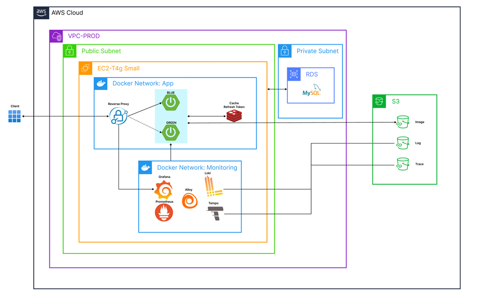

<div align="center">


<h3>동아리 운영과 커뮤니티를 한 곳에서</h3>

출석, 게시판, 멤버 관리, 회비까지. Weeth 서비스를 떠받치는 백엔드 API 서버입니다.

<br />

[](https://kotlinlang.org/)
[](https://spring.io/projects/spring-boot)
[](https://www.mysql.com/)
[](https://redis.io/)

[**weeth.kr 바로가기**](https://weeth.kr) · [**Frontend Repository**](https://github.com/Team-Weeth/weeth-client)

<sub>[팀원](#팀원) · [소개](#소개) · [미리보기](#미리보기) · [주요 기능](#주요-기능) · [시스템 아키텍처](#시스템-아키텍처) · [기술 스택](#기술-스택) · [설계](#설계) · [시작하기](#시작하기)</sub>

</div>

<br />

## 팀원

<div align="center">
<table>
  <tr>
    <td align="center"><a href="https://github.com/hyxklee"><br /><sub><b>이강혁</b></sub></a></td>
    <td align="center"><a href="https://github.com/woneeeee"><br /><sub><b>김지원</b></sub></a></td>
    <td align="center"><a href="https://github.com/soo0711"><br /><sub><b>전수현</b></sub></a></td>
  </tr>
</table>
</div>

<br />

## 소개

- Weeth는 동아리 운영에서 반복되는 일들을 하나의 서비스로 정리했습니다.
- 한 번 가입하면 여러 동아리에 동시에 소속되어 활동할 수 있습니다. 서버는 모든 데이터를 **동아리(Club) 단위로 격리**하고, 동아리마다 기수·역할·권한을 따로 관리합니다.
- 웹과 iOS·Android 앱이 이 서버 하나를 함께 사용합니다.

<div align="center">
<table>
<tr width="100%">
<td width="50%" valign="top">

**회원은 이렇게 써요**

- 세션마다 출석 코드·QR로 출석
- 공지 확인하고 게시판에서 소통
- 캘린더로 다가오는 일정 확인
- 내 출석률·패널티·회비 납부 상태 확인

</td>
<td width="50%" valign="top">

**운영진은 이렇게 써요**

- 세션 생성하고 출석 관리
- 멤버·기수·패널티 관리
- 게시판 개설 및 권한 설정
- 회비·거래 내역 관리

</td>
</tr>
</table>
</div>

<br />

## 미리보기

<table>
  <tr>
    <td width="50%"></td>
    <td width="50%"></td>
  </tr>
  <tr>
    <td align="center"><sub>캘린더</sub></td>
    <td align="center"><sub>출석</sub></td>
  </tr>
  <tr>
    <td width="50%"></td>
    <td width="50%"></td>
  </tr>
  <tr>
    <td align="center"><sub>멤버 관리 (운영진)</sub></td>
    <td align="center"><sub>회비 관리 (운영진)</sub></td>
  </tr>
</table>

<table>
  <tr>
    <td width="25%"></td>
    <td width="25%"></td>
    <td width="25%"></td>
    <td width="25%"></td>
  </tr>
  <tr>
    <td align="center"><sub>홈</sub></td>
    <td align="center"><sub>캘린더</sub></td>
    <td align="center"><sub>출석</sub></td>
    <td align="center"><sub>마이페이지</sub></td>
  </tr>
</table>

<sub>전체 화면은 [weeth-client README](https://github.com/Team-Weeth/weeth-client#미리보기)에서 볼 수 있습니다.</sub>

<br />

## 주요 기능

<table>
<tr>
<td width="50%" valign="top">

### 인증
Kakao·Apple 소셜 로그인 · JWT(Access/Refresh) · 쿠키 기반 토큰 전달

</td>
<td width="50%" valign="top">

### 동아리 · 기수
멀티 동아리 소속 · 가입 신청/승인 · 기수(Cardinal)별 활동 이력 · 역할 기반 권한

</td>
</tr>
<tr>
<td valign="top">

### 세션 · 출석
정기 세션 관리 · 출석 코드·QR 출석 체크 · 출석률 집계

</td>
<td valign="top">

### 게시판
공지/일반 게시판 · 게시판별 권한 · 댓글·대댓글 · S3 파일 첨부

</td>
</tr>
<tr>
<td valign="top">

### 회비 · 패널티
기수별 회비 납부 대상 관리 · 거래 내역 · 패널티 규칙과 경고 누적

</td>
<td valign="top">

### 일정 · 알림
캘린더 일정 · 공지 등록 시 FCM 푸시 알림 · 대시보드 집계

</td>
</tr>
</table>

<br />

## 시스템 아키텍처

<div align="center">

</div>

- **무중단 배포** — EC2(ARM64) 위에서 Caddy가 `app-blue`/`app-green` 두 컨테이너 앞단을 맡습니다. 새 컨테이너가 `/actuator/health`를 통과하면 upstream을 전환하고 이전 컨테이너를 내립니다.
- **관측성** — 모니터링 스택은 앱과 분리된 Docker 네트워크에서 돕니다. Grafana Alloy가 컨테이너 로그를 Loki로 보내고(저장소는 S3), Prometheus가 앱·Redis·호스트 메트릭을 수집합니다. Grafana는 Caddy 뒤 서브경로로 노출됩니다.
- **데이터** — 운영 DB는 RDS(MySQL 8)를 씁니다. Redis에는 Refresh Token, Access Token 블랙리스트, QR 출석 토큰, 캐시를 둡니다. 파일은 S3 + CDN으로 서빙합니다. dev·prod 스키마는 Flyway 마이그레이션으로만 바꾸고, Hibernate는 `validate`로 검증만 합니다.

### CI/CD

| 워크플로우 | 트리거 | 동작 |
|-----------|--------|------|
| CI | PR / Push (`dev`, `main`) | ktlint 검사 → 빌드 → 테스트 |
| Deploy Dev | `dev` CI 성공 | ARM64 이미지 빌드 → Docker Hub → Dev EC2 Blue-Green 배포 |
| Release Create | `main` PR 머지 | Draft Release 생성·갱신 |
| Deploy Prod | Release 발행 | ARM64 이미지 빌드 → Docker Hub → Prod EC2 Blue-Green 배포 |
| Backmerge | `main` Push | `main` → `dev` 백머지 PR 생성 |

<br />

## 기술 스택

<table>
  <tr>
    <td><b>Core</b></td>
    <td>
      
      
      
      
    </td>
  </tr>
  <tr>
    <td><b>Data</b></td>
    <td>
      
      
      
      
    </td>
  </tr>
  <tr>
    <td><b>External</b></td>
    <td>
      
      
      
      
    </td>
  </tr>
  <tr>
    <td><b>Testing</b></td>
    <td>
      
      
      
      
    </td>
  </tr>
  <tr>
    <td><b>Infra</b></td>
    <td>
      
      
      
      
      
    </td>
  </tr>
  <tr>
    <td><b>Observability</b></td>
    <td>
      
      
      
      
    </td>
  </tr>
</table>

<br />

## 설계

```
presentation → application → domain ← infrastructure
```

- **Rich Domain Model** — 비즈니스 규칙, 검증, 상태 전이는 Entity가 가집니다. UseCase는 흐름만 조율합니다.
- **Command / Query 분리** — Command UseCase는 `@Transactional`, Query UseCase는 `readOnly = true`로 나눕니다.
- **Port-Adapter** — 도메인이 Port 인터페이스를 정의하고, S3·FCM·Slack 같은 외부 연동은 infrastructure의 Adapter가 구현합니다.
- **아키텍처 테스트** — 레이어 의존 방향과 패키지 규칙을 [Konsist](https://docs.konsist.lemonappdev.com/) 테스트로 CI에서 강제합니다.
- **일관된 응답 포맷** — 모든 응답은 `CommonResponse<T>`로 감싸고, 5자리 코드 `XDDNN`(X: 결과 분류, DD: 도메인, NN: 순번)으로 결과를 구분합니다.

자세한 규칙은 [`.claude/rules`](.claude/rules)에 정리되어 있습니다.

### 프로젝트 구조

```text
src/main/kotlin/com/weeth/
├── domain/
│   ├── user/           # 회원, 소셜 로그인, 마이페이지
│   ├── club/           # 동아리, 멤버, 가입 신청
│   ├── cardinal/       # 기수
│   ├── session/        # 정기 세션
│   ├── attendance/     # 출석
│   ├── schedule/       # 일정
│   ├── board/          # 게시판, 게시글
│   ├── comment/        # 댓글, 대댓글
│   ├── file/           # 파일 업로드 (S3)
│   ├── account/        # 회비, 거래 내역
│   ├── penalty/        # 패널티
│   ├── notification/   # 알림, FCM 푸시
│   ├── dashboard/      # 대시보드 집계
│   ├── feedback/       # 서비스 피드백
│   └── university/     # 대학·학과 정보
└── global/
    ├── auth/           # JWT, OAuth2, @CurrentUser
    ├── config/         # Spring 설정
    ├── common/         # 공통 응답, 예외, ID 생성
    └── logging/        # 접근 로그, 민감정보 마스킹
```

<br />

## 시작하기

**사전 요구사항:** JDK 21, MySQL 8.0, Redis 7.0+, 환경 변수(`.env`, 팀 내부 공유)

```bash
./gradlew bootRun       # 로컬 실행 (local 프로파일)
./gradlew test          # 전체 테스트 (Docker 필요 — Testcontainers)
./gradlew ktlintFormat  # 코드 포맷팅
```

| Profile | 용도 | DDL | Swagger |
|---------|------|-----|---------|
| `local` (기본) | 로컬 개발 | `update` | 활성화 |
| `local-monitoring` | 로컬 + 모니터링 스택(`infra/local/monitoring`) | `update` | 활성화 |
| `dev` | 개발 서버 | `validate` + Flyway | 활성화 |
| `prod` | 운영 서버 | `validate` + Flyway | 비활성화 |

<br />

<div align="center">
<sub>Copyright 2024 Weeth Team</sub>
</div>
